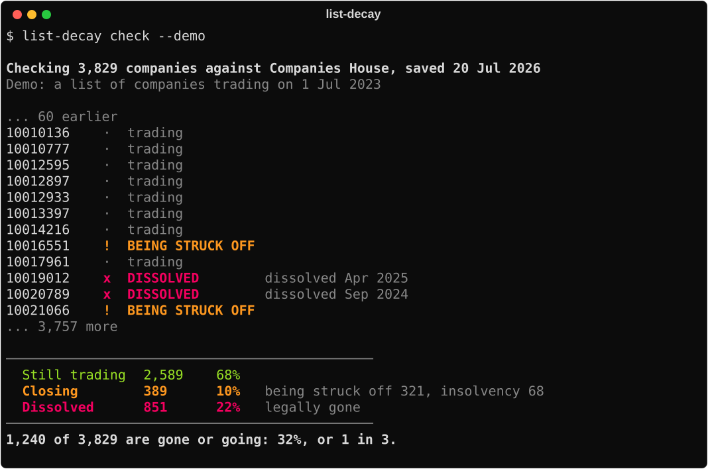

<p align="center">
  
</p>

<h1 align="center">list-decay</h1>

<p align="center">
  <strong>Check your UK company list against Companies House before you spend money on it.</strong>
</p>

<p align="center">
  <a href="https://github.com/scordsy/list-decay/actions/workflows/ci.yml"></a>
  
  
  <a href="LICENSE"></a>
</p>

> [!IMPORTANT]
> **UK companies only.** list-decay checks companies registered with Companies House: England, Wales, Scotland and Northern Ireland. It can't check a company registered anywhere else, and sole traders and ordinary partnerships aren't on the register.

Most list cleaning starts with the contacts. Verify the emails, catch the job changes, enrich what's missing.

But if the company has gone, none of that matters. And a dissolved company doesn't always look dissolved. The domain can stay paid up for years. The old inbox can keep accepting mail. Some mail servers accept everything, so a verifier waves the address through. The email looks fine, with no company left to buy.

**Without list-decay**

- You pay to enrich, verify and sequence companies that no longer exist.
- They drag your reply rate down, so good copy gets rewritten for the wrong reason.
- Nothing in your CRM tells you a company was dissolved last spring.

**With list-decay**

- Every company on your list gets a verdict from the live register: trading, closing or dissolved.
- Closing companies say how: liquidation, administration, or being struck off.
- No company numbers in your CRM? `list-decay find` fills them in from the names, and only when it's certain.
- It costs nothing. The Companies House API is free, and list-decay needs nothing installed beyond Python.

## What a three-year-old list looks like

I took 3,829 companies in England and Wales that were trading on 1 July 2023, the kind of list you'd have built or bought back then, and re-checked every one against the register in July 2026.

| | Companies | Share |
|---|---:|---:|
| Still trading | 2,589 | 68% |
| Closing | 389 | 10% |
| Dissolved | 851 | 22% |

**One in three dissolved or closing, before you've touched a contact.** Replay that exact run yourself in seconds, no API key needed:

```bash
list-decay check --demo
```

## Quick start

```bash
pipx install git+https://github.com/scordsy/list-decay
list-decay check --demo
```

Then check your own list (you'll need a free key, two minutes, [see below](#get-a-free-companies-house-api-key)):

```bash
export CH_API_KEY=your-key
list-decay check my-list.csv --out results.csv
```

No `pipx`? `pip install git+https://github.com/scordsy/list-decay` works too. Or clone the repo and run `python3 -m list_decay check --demo` from inside it, with nothing installed at all.

## Get a free Companies House API key

Checking or finding numbers for your own list needs a key. It's free:

1. Register with the [Companies House Developer Hub](https://developer.company-information.service.gov.uk/).
2. Under [Your applications](https://developer.company-information.service.gov.uk/manage-applications), create an application for the **live** environment.
3. Create a **REST** key for it.
4. `export CH_API_KEY=your-key`, or copy [`.env.example`](.env.example) to `.env` and paste the key in.

Companies House allows 600 lookups every five minutes. list-decay paces itself just under that and never trips the limit, so a list of 1,000 companies takes nine minutes. If the service stumbles, it waits and retries.

## What goes in

A CSV or a plain text file, straight out of your CRM or a spreadsheet. list-decay reads **one column, the company number**, and ignores everything else. You can check a list without handing over anything about the people on it.

- It finds the column by its header (`Company Number`, `company_number`, `CRN`, `Registration number` and the like), or uses the first column.
- It repairs what spreadsheets do to company numbers: dropped leading zeros (`8500000` becomes `08500000`), a trailing `.0`, stray spaces, lowercase prefixes (`sc123456` becomes `SC123456`).
- Comma, semicolon, tab and pipe separators all work, and so do older Excel exports.
- Duplicates are checked once. Rows it can't read are listed by line number, never dropped silently.

### No company numbers in your CRM?

Most CRMs hold a company name, not a company number. `list-decay find` fills the numbers in from the names, then `check` takes it from there:

```bash
list-decay find crm-export.csv
list-decay check crm-export-numbers.csv
```

It searches the register for each name and fills in a number only when it's certain:

| Result | What it means |
|---|---|
| **Matched** | Exactly one company on the register has that name, and the registered postcode agrees if your file has a postcode column |
| **Check by hand** | More than one company has that name, or the right name has a different legal form, or the postcode doesn't agree. Every candidate is in the file for you to pick from |
| **No match** | Nothing on the register has that name. The three closest candidates are listed |

"That name" ignores case, punctuation, accents, "&" versus "and", a leading "The" and spellings of the same legal form ("Ltd", "Limited"). It never ignores a different legal form: "Acme LLP" won't match "Acme Limited". And it never guesses. A wrong number would give a confident verdict about the wrong company, which is worse than no verdict ([the full rules](docs/adr/0004-find-fills-in-a-number-only-when-certain.md)).

Your file comes back with every original column kept, plus `match`, `matched_on` and `candidates`, so it can go straight back into your CRM. If it already has a company number column, `find` fills in the gaps and leaves the numbers already there alone. Otherwise it adds a `company_number` column.

The file needs a header row naming the company name column (`Company Name`, `Account Name`, `Organisation` and the like). A plain `Name` column doesn't count, because in a contacts export that's usually a person. A postcode column is picked up if there is one.

For a handful of companies, the free [Companies House search](https://find-and-update.company-information.service.gov.uk/) works too.

## What comes out

Every company gets one verdict:

| Verdict | What the register says |
|---|---|
| **Trading** | Active, with nothing underway to close it |
| **Closing** | Still on the register, but closure has started: liquidation, administration, receivership, or a proposal to strike it off |
| **Dissolved** | Removed from the register, with the month it was dissolved |
| **Unclear** | On the register with a status list-decay doesn't recognise. Rare. Counted, never guessed at |
| **Not found** | No company has that number, usually a typo. Left out of the percentages |

| Option | Does |
|---|---|
| `--out results.csv` | Writes one row per company: number, verdict, how it's closing, date dissolved, registered name |
| `--names` | Shows each company's registered name as it's checked |
| `--quiet` | Prints the summary only |
| `--demo` | Checks the built-in 2023 list against the bundled snapshot, no key needed |

## How the "one in three" was measured

The obvious way to measure list decay doesn't work. Companies House publishes a free bulk download of the register, but it leaves dissolved companies out. They aren't flagged, they just disappear. Sample from it and you will never see decay at all.

So `list-decay study` rebuilds the past, dissolved companies included:

1. **Find the right companies.** England and Wales company numbers are issued in order, and the API still answers for dissolved companies. A binary search finds the band of numbers issued between two dates.
2. **Draw at random.** Numbers are drawn from that band and looked up one by one, keeping companies that were open on the day the list would have been built.
3. **Re-check them today.** One sample gives the whole curve: a list built one, two or three years ago.
4. **Try to break the number.** Every figure is re-run on three groups: all companies, real prospects (company types a B2B list is built from, not dormant, filing real accounts), and operating businesses (real prospects minus holding companies and property vehicles). The headline uses real prospects because that group gives the lowest number of the three at every list age. At three years it's 32.4%, against 38.3% for all companies and 35.1% for operating businesses. Dormant shells and property vehicles aren't propping it up.
5. **Put error bars on it.** Every "gone or going" figure carries a 95% confidence interval.

```bash
list-decay study           # reproduce the published curve from the bundled sample, no key
list-decay study --live    # draw a fresh sample from the live register (needs a key)
```

<details>
<summary><strong>The full curve</strong></summary>

From the bundled sample: 5,000 England and Wales companies incorporated 2016 to 2021, checked on 20 July 2026. "Gone or going" is dissolved plus closing.

| List built | Age | Real prospects on the list | Dissolved | Gone or going | 95% CI |
|---|---:|---:|---:|---:|---:|
| 1 Jul 2025 | 1.1 years | 3,260 | 8.7% | 20.6% | 19.2 to 22.0% |
| 1 Jul 2024 | 2.1 years | 3,550 | 16.1% | 27.1% | 25.6 to 28.6% |
| 1 Jul 2023 | 3.1 years | 3,829 | 22.2% | 32.4% | 30.9 to 33.9% |

`list-decay study` prints the same table for all three groups.

</details>

<details>
<summary><strong>Running a live study</strong></summary>

A live study makes a lot of lookups: the July 2026 run took 10,882 to keep 5,000 companies, just over an hour and a half at the rate limit. Every lookup is saved in `.list-decay-cache/`, so you can stop it and pick up where you left off, and a re-run costs nothing. The sample is saved as a CSV in the same folder.

```bash
list-decay study --live --size 1000 --incorporated 2016-01-01 2021-12-31 --list-dates 2025-07-01,2024-07-01,2023-07-01
```

</details>

## Read it with care

- **UK companies only.** The study covers England and Wales companies incorporated 2016 to 2021.
- **Being struck off isn't always the end.** It often starts with late filing, and some companies file and carry on. That's why the study reports it separately from insolvency.
- **A name match proves the name, not the business.** If your CRM holds trading names rather than registered names, "Acme" in your CRM might not be ACME LTD on the register. Add a postcode column and `find` checks the registered postcode as well as the name. The register holds the registered office, often an accountant's address, so a postcode that differs sends the row to check by hand rather than throwing it away.
- **A company that's still trading can still be a bad lead.** list-decay checks the company, not the person.
- **The bundled snapshot is from 20 July 2026.** `--demo` and `study` replay it exactly. Checking your own list is always live.

## How it's built

- Python 3.10 or newer, **standard library only**: nothing to install, nothing to break ([why](docs/adr/0002-standard-library-only.md)).
- Tests where it matters: reading messy lists, checking a list against a register, finding numbers from names, the live connection (against a fake Companies House, including rate limits and outages), and the study reproducing the published figures to the decimal.
- Every change runs strict type checks, linting and the tests, on Linux, macOS and Windows.
- [`GLOSSARY.md`](GLOSSARY.md) pins down the words, and [`docs/adr`](docs/adr) records the decisions you might question.

I build with Claude Code. I own the design, the data logic and the checks, and Claude writes most of the code. [`CLAUDE.md`](CLAUDE.md) is the brief it works from.

## Licence

[MIT](LICENSE). Company data contains public sector information licensed under the [Open Government Licence v3.0](https://www.nationalarchives.gov.uk/doc/open-government-licence/version/3/), from Companies House.

## About

Built by **Stefan Cordery**. Marketing leader turned builder, 14+ years in B2B marketing, now building GTM systems in Claude Code: TAM and ICP scoring, enrichment, buying signals, outbound and CRM workflows.

- [Follow me on LinkedIn](https://www.linkedin.com/in/stefancordery/)
- [The post this started from](https://www.linkedin.com/posts/stefancordery_your-email-copy-might-be-fine-a-third-of-ugcPost-7519357314777378816-7waE/)
- **Want your list checked without running anything?** [Message me on LinkedIn](https://www.linkedin.com/in/stefancordery/) with the company numbers. Numbers only, no contacts, and I delete the file afterwards.
